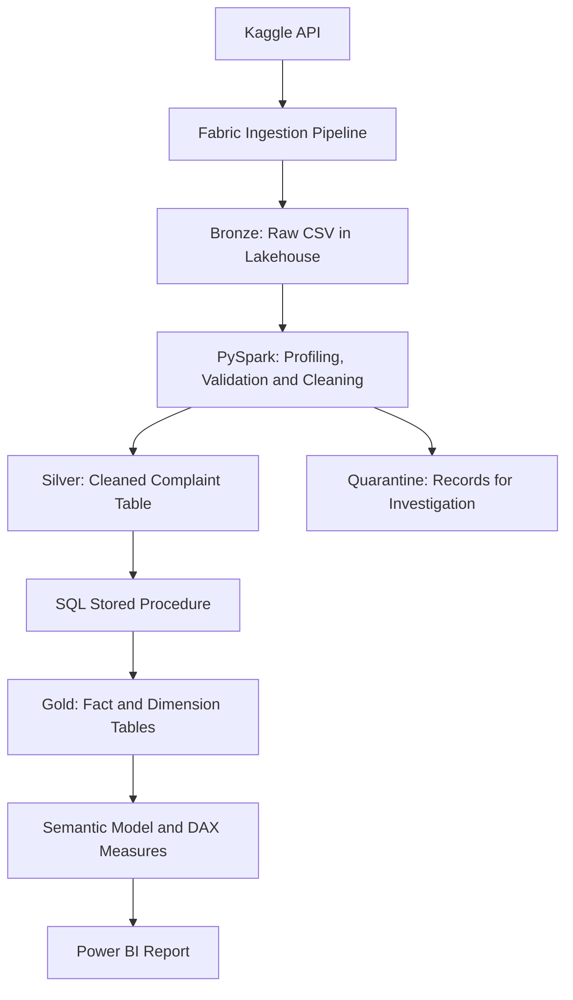

# Microsoft Fabric — CFPB Consumer Complaint Analytics

An end-to-end data engineering and analytics project built with Microsoft Fabric, using **903,983 historical consumer financial complaint records**.

The project follows the complete journey from raw CSV ingestion to a Power BI report, including data quality checks, category standardization, dimensional modeling, pipeline orchestration and DEV-to-PROD deployment.

Created by **Rutuja Kadam | DataToCrunch**.

## Project Overview

Consumer complaints provide insight into the financial products, issues and company responses that consumers report.

This project explores:

- How complaint volumes change over time.
- Which products, issues and companies account for the most complaints.
- How consumers submit complaints.
- How often companies provide timely responses.
- How consumer dispute rates vary by response outcome.

The implementation explains the reasoning behind data-cleaning decisions, including when to standardize a value, preserve missing information or quarantine a record.

## Architecture

A separate end-to-end data pipeline orchestrates ingestion, Silver processing and Gold loading.

Fabric deployment pipelines support promotion from Development to Production.

## Technology Stack

| Component | Technology |
|---|---|
| Source ingestion | Kaggle API and Fabric Data Pipeline |
| Raw and cleaned storage | Microsoft Fabric Lakehouse |
| Data transformation | PySpark notebook |
| Analytical storage | Fabric Warehouse |
| Gold loading | SQL stored procedure |
| Data modeling | Fact and dimension tables |
| Analytics | Semantic model and DAX |
| Visualization | Power BI |
| Orchestration | Fabric Data Pipelines |
| Environment promotion | Fabric Deployment Pipelines |

## Dataset

The project uses a historical CFPB consumer complaint dataset retrieved from Kaggle.

- **Source records:** 903,983
- **Source columns:** 18
- **Cleaned Silver records:** 896,931
- **Quarantined records:** 7,052

The Consumer Financial Protection Bureau (CFPB) is the original source of the complaint information.

These counts describe the dataset snapshot used in this project. A different download may contain different records.

## Bronze Layer

The ingestion pipeline downloads the source archive and extracts the CSV into the Lakehouse.

The raw file is preserved for traceability and reprocessing.

CSV parsing accounts for:

- A header row.
- Quoted fields containing commas.
- Actual line breaks inside quoted fields.
- Escaped quotation marks.

## Silver Layer

### Data Profiling

The notebook examines:

- Row and column counts.
- Column types.
- Complaint ID uniqueness.
- Missing values.
- Category variations.
- Date and ZIP-code patterns.

### Date Validation and Quarantine

Dates are converted into date columns.

Records where `date_sent_to_company` is earlier than `date_received` are separated into a quarantine table.

The project does not guess corrected dates. Quarantined records remain available for investigation.

### Product and Sub-product Standardization

Product and sub-product mappings use CFPB’s documented April 2017 category changes.

Specific sub-product exceptions are evaluated before broader product rules.

Original values are retained alongside:

- `product_standardized`
- `sub_product_standardized`

Historical categories without a suitable documented replacement are retained.

### Issue and Sub-issue Standardization

Issue and sub-issue mappings are **project-defined reporting choices** based on wording, interpreted meaning and product context where applicable.

They are **not presented as an official CFPB historical crosswalk**.

The original fields remain available alongside:

- `issue_standardized`
- `sub_issue_standardized`

This preserves traceability and allows the mappings to be reviewed or revised.

### Missing Values

Missing values are investigated before deciding how to handle them.

The project avoids inventing information simply to remove blanks. For example, a missing consumer dispute status is not automatically treated as “No.”

### Company Names

Company-name cleanup addresses hidden spacing characters and formatting inconsistencies while preserving meaningful text.

### ZIP Codes

ZIP values are handled as text.

The notebook:

- Recognizes five-digit and already-masked values.
- Applies state-and-prefix rules to selected shortened values.
- Sets unreliable values to null while retaining the complaint.
- Produces a final non-null format of three digits followed by `XX`.

State-and-prefix checks assess plausibility; they do not verify a complete postal address.

### Reconciliation

The valid and quarantined record counts reconcile to the source:

896,931 + 7,052 = 903,983

## Gold Layer

The Gold layer uses a dimensional model in Fabric Warehouse.

It includes:

- A complaint fact table.
- Dimensions for dates, products, issues, companies and other reporting attributes.
- Surrogate keys connecting facts to dimensions.
- A SQL stored procedure, `gold.sp_load_gold`, to load the analytical tables.

The date dimension supports consistent reporting by year, quarter, month and day.

## Semantic Model and Measures

The semantic model connects the Gold tables for reporting.

Measures include:

- Total Complaints.
- Timely Response %.
- Consumer Dispute %.
- Average Days to Send to Company.
- Complaints by Sent Date.

### Metric Definitions

**Timely Response %**

Complaints with timely response marked “Yes,” divided by total complaints in the current filter context.

**Consumer Dispute %**

Complaints with consumer dispute status “Yes,” divided by complaints with a known status of “Yes” or “No.”

Missing dispute statuses are excluded from this denominator.

**Complaints by Sent Date**

Uses the sent-date relationship to analyze complaints by the date they were sent to the company.

## Power BI Report

### 1. Complaint Overview

- Total complaints.
- Timely response percentage.
- Consumer dispute percentage.
- Average days to send to company.
- Complaint trends and date drill-down.

### 2. Complaint Drivers

- Product and issue analysis.
- Company concentration.
- Submission channels.
- Interactive exploration of complaint drivers.

### 3. Response and Resolution

- Dispute rates by response outcome.
- Response timeliness.
- Company performance comparisons.
- Company scorecard.

## Pipeline Orchestration

The end-to-end pipeline connects:

1. Source ingestion.
2. Bronze-to-Silver notebook execution.
3. Gold-layer loading through the stored procedure.

Activity dependencies control the execution order, and run history supports monitoring and troubleshooting.

## DEV-to-PROD Deployment

The project demonstrates deployment using Fabric deployment pipelines.

For the first deployment into an empty target environment, the walkthrough uses two rounds.

### Round 1 — Ingestion and Silver

Deploy:

- Lakehouse.
- Ingestion pipeline.
- Bronze-to-Silver notebook.

Then:

1. Verify that connections and notebook Lakehouse bindings target the intended environment.
2. Run the ingestion pipeline.
3. Run the notebook.
4. Confirm that `silver.consumer_complaints` is available through the target Lakehouse SQL analytics endpoint.

### Round 2 — Gold and Reporting

Deploy:

- Fabric Warehouse.
- End-to-end data pipeline.
- Semantic model.
- Power BI report.

Then verify the target bindings, run the pipeline to populate Gold, and check report access to the target data.

This sequence establishes the Silver dependency referenced by the Gold-loading procedure before deploying the Warehouse.

Later deployments should also account for any newly introduced dependencies.

### CI/CD Scope

This project demonstrates manually triggered DEV-to-PROD promotion using deployment pipelines.

It does not implement a complete Git-triggered build, automated test and deployment workflow.

## Reproducing the Project

1. Obtain the source dataset used in the tutorial.
2. Create the required Fabric workspace and Lakehouse.
3. Configure the ingestion pipeline’s source connection and destination.
4. Run ingestion and confirm that the CSV is available.
5. Attach the Bronze-to-Silver notebook to the intended Lakehouse.
6. Run the notebook and review validation and reconciliation results.
7. Create the Gold Warehouse objects and loading procedure.
8. Configure and run the end-to-end pipeline.
9. Configure the semantic model and Power BI report.
10. Follow the staged deployment process for a new target environment.

Update workspace references, item identifiers, connection settings and source paths for your own environment.

## References

- [CFPB Consumer Complaint Database](https://www.consumerfinance.gov/data-research/consumer-complaints/)
- [CFPB April 2017 Product and Sub-product Changes](https://files.consumerfinance.gov/f/documents/201704_cfpb_Summary_of_Product_and_Sub-product_Changes.pdf)

**Kaggle dataset:** Add the exact dataset URL used in the project.

**Full video tutorial:** Add the DataToCrunch YouTube tutorial URL.

## Author

**Rutuja Kadam — DataToCrunch**

Hands-on data engineering projects covering Microsoft Fabric, Databricks and Power BI.
